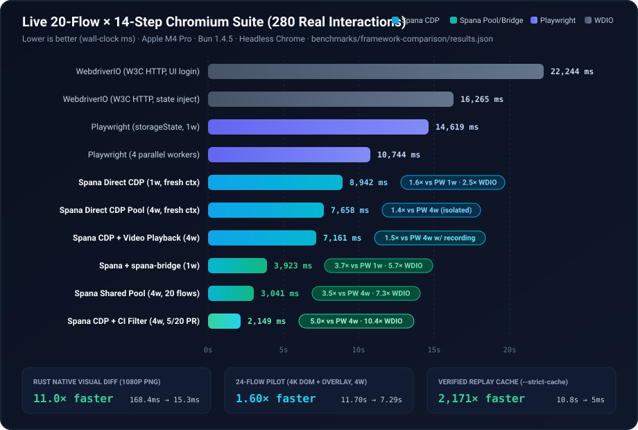
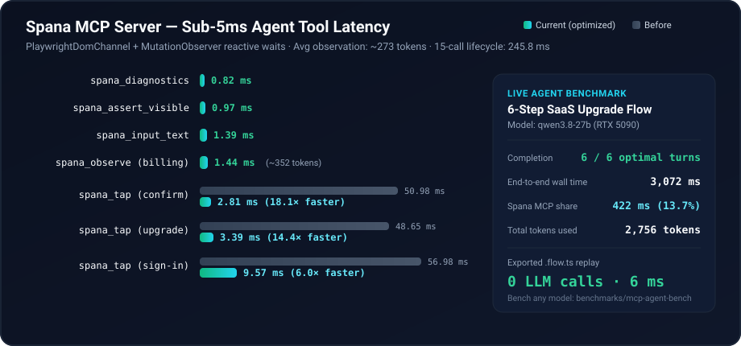
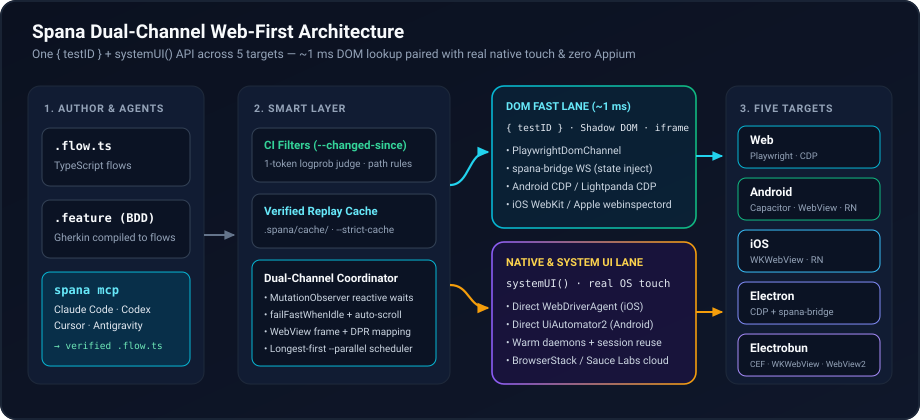
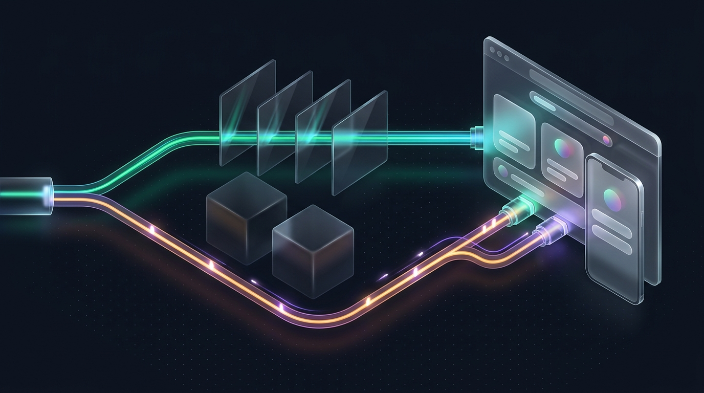

<p align="center">
  
</p>

<h1 align="center">spana</h1>

<p align="center">
  <strong>One test. Every screen.</strong><br />TypeScript E2E testing for Web, iOS &amp; Android (Capacitor / React Native), Electron, and Electrobun — one <code>{ testID }</code> selector, no Appium to set up, and an MCP server your coding agent can drive.
</p>

<p align="center">
  <a href="https://www.npmjs.com/package/spana-test"></a>
  <a href="./LICENSE"></a>
  <a href="#platforms"></a>
</p>

<p align="center">
  <a href="https://spana.antonwester.se/">Documentation</a> ·
  <a href="#benchmarks">Benchmarks</a> ·
  <a href="#architecture">Architecture</a> ·
  <a href="#agent-integration--mcp-server">MCP Server</a> ·
  <a href="https://htmlpreview.github.io/?https://github.com/wezter96/spana/blob/main/docs/e2e-report.html">Live HTML Report</a>
</p>

---

## Features

- **5 targets from one suite:** Web (Playwright, warm Chromium daemon, or CDP-direct Lightpanda), Android (Capacitor/WebView & React Native), iOS (WKWebView & React Native), Electron, and Electrobun
- **Dual-channel web-first engine (zero Appium required):** ~1 ms DOM queries via built-in `PlaywrightDomChannel`, `spana-bridge`, Android CDP, iOS WebKit Inspector, or Apple `webinspectord` (with Shadow DOM & same-origin `<iframe>` piercing), paired with direct UiAutomator2 / WebDriverAgent for real native touches and OS sheets (`systemUI()`)
- **Engineered for raw speed:** `MutationObserver` reactive DOM waits + optional `failFastWhenIdle`, speculative CLI browser pre-launch, persistent warm Chromium / WDA / UiAutomator2 daemons (`spana daemon`), single-browser multi-context worker pools, `instantAnimations` / `blockResources`, auto-persisted longest-first `--parallel` scheduling, and byte-identical screenshot short-circuiting
- **Pluggable CI Filters API (`--changed-since <ref>`):** `decisionFilter` (including native 1-token KV-cache logprob judge `createLogprobDecisionJudge` and local Ollama batch judge `createOllamaDecisionJudge`) + `pathRuleFilter` with fail-open safety defaults so PRs only run affected flows
- **Model-free MCP server (`spana mcp`):** lets Claude Code, Codex, Cursor, and Antigravity drive live sessions across all 5 targets at sub-5 ms tool latency, inspect unified diagnostics, and export verified `.flow.ts` code
- **Composable lazy fixtures, named setups & Verified Replay Cache:** `createFlowWithFixtures`, `defineSetup`, and `.spana/cache/` (`--strict-cache`) for 0-LLM deterministic CI replay
- **Pure TypeScript flows + optional Gherkin / BDD `.feature` parity** with smart waits, relative selectors, auto-scroll for offscreen DOM targets, and `layout-tolerant` visual diffing
- **Rich reporters & diagnostics:** console, JSON, JUnit XML, HTML, Allure, and GitHub PR summary (`--reporter github`), plus self-contained `failure-bundle.json` with inline console logs & JS errors
- **Built-in cloud device farms:** direct W3C Appium client with first-class **BrowserStack** and **Sauce Labs** helpers (no WebdriverIO required)

---

## Benchmarks

All benchmarks are reproducible directly from this repository on Apple M4 Pro (Bun 1.4.5, Headless Chrome).

### 20-Flow × 14-Step Chromium Suite (280 Interactions) & Mobile Hybrid

<p align="center">
  
</p>

| Strategy                              | Mode           | Flows | Filter (ms) | Total (ms) | Speedup           |
| ------------------------------------- | -------------- | ----: | ----------: | ---------: | ----------------- |
| WebdriverIO (W3C HTTP, UI login)      | 1w, fresh      |    20 |           0 |     22,244 | baseline (WDIO)   |
| WebdriverIO (W3C HTTP, state inject)  | 1w, inject     |    20 |           0 |     16,265 | —                 |
| Playwright (`storageState`, 1w)       | 1w, fresh ctx  |    20 |           0 |     14,619 | baseline (PW 1w)  |
| Playwright (4 parallel workers)       | 4w, fresh ctx  |    20 |           0 |     10,744 | baseline (PW 4w)  |
| **Spana Direct CDP (1w)**             | 1w, fresh ctx  |    20 |           0 |  **8,942** | **1.6× vs PW 1w** |
| **Spana Direct CDP Pool (4w)**        | 4w, fresh ctx  |    20 |           0 |  **7,658** | **1.4× vs PW 4w** |
| **Spana CDP + Video Playback (4w)**   | 4w, screencast |    20 |           0 |  **7,161** | **1.5× vs PW 4w** |
| **Spana + `spana-bridge` (1w)**       | 1w, bridge     |    20 |           0 |  **3,923** | **3.7× vs PW 1w** |
| **Spana Shared Pool (4w)**            | 4w, warm pool  |    20 |           0 |  **3,041** | **3.5× vs PW 4w** |
| **Spana CDP + `pathRuleFilter` (4w)** | 4w, PR diff    |     5 |           0 |  **2,149** | **5.0× vs PW 4w** |

- **24-Flow Realistic Pilot (4,000-cell DOM + hydration overlay + offscreen scroll, fresh context/test):** Playwright 4w `11.70 s` (`1,177 ms` median) → **Spana Direct CDP 4w `7.29 s`** (**1.60× faster wall**, `865 ms` median, 24/24 pass)
- **Rust Native Visual Regression Diff (1920×1080 PNG):** Pure-JS `168.4 ms` → **`15.3 ms`** (**11.0× faster**)
- **Verified Replay Cache (`--strict-cache`) vs Live LLM:** `10,859 ms` → **`5 ms`** (**2,171× faster**, 0 LLM calls)
- **Capacitor Mobile Hybrid (5 flows, zero Appium):** iOS `28.4 s` (WDIO/Appium) → **`1.52 s`** (**18.7× faster**) · Android `22.9 s` → **`1.27 s`** (**18.0× faster**)

```bash
bun run benchmarks/framework-comparison/benchmark.ts
```

### MCP Server Tool Latency & Live Agent Performance

<p align="center">
  
</p>

Benchmark Spana's stdio MCP server with **any** local Ollama, OpenAI-compatible, or hosted model:

```bash
bun run benchmarks/mcp-agent-bench/benchmark.ts --model ollama/qwen2.5:1.5b
bun run benchmarks/mcp-agent-bench/benchmark.ts --base-url http://127.0.0.1:8000/v1 --model openai/qwen3.8-27b
```

---

## Quick Start

```bash
npm install spana-test
# or
bun add spana-test
```

Create `spana.config.ts`:

```ts
import { defineConfig } from "spana-test";

export default defineConfig({
  apps: {
    web: { url: "http://localhost:3000" },
    android: {
      packageName: "com.example.app",
      appPath: "./builds/app.apk",
    },
    ios: {
      bundleId: "com.example.app",
      appPath: "./builds/MyApp.app",
    },
  },
  platforms: ["web", "android"],
  reporters: ["console", "html"],
  artifacts: {
    outputDir: ".spana/artifacts",
    captureOnFailure: true,
  },
});
```

Create `flows/login.flow.ts`:

```ts
import { flow } from "spana-test";

export default flow("user can log in", async ({ app, expect }) => {
  await app.tap({ testID: "email-input" });
  await app.inputText("user@example.com");
  await app.dismissKeyboard();
  await app.tap({ testID: "password-input" });
  await app.inputText("secret");
  await app.dismissKeyboard();
  await app.tap({ testID: "login-button" });
  await expect({ testID: "home-screen" }).toBeVisible();
});
```

Run:

```bash
spana validate-config
spana validate ./flows
spana test
```

---

## Capability Matrix

| Capability                                                | Web | Local Android / iOS (Direct)         | Electron / Electrobun      | Appium cloud                               |
| --------------------------------------------------------- | --- | ------------------------------------ | -------------------------- | ------------------------------------------ |
| TypeScript `.flow.ts` & Gherkin `.feature` suites         | Yes | Yes                                  | Yes                        | Yes                                        |
| `{ testID }` DOM queries + Shadow DOM / `<iframe>` pierce | Yes | Yes (CDP / WebKit / `spana-bridge`)  | Yes (CDP / `spana-bridge`) | Via WebView context                        |
| Native OS sheets / OAuth (`systemUI(...)`)                | n/a | Yes (direct UiAutomator2 / WDA)      | Via native/bridge          | Yes                                        |
| Storage inject, fast reset, idle & network mock           | Yes | Yes (via `spana-bridge`)             | Yes (CDP / `spana-bridge`) | No                                         |
| Warm daemons / shared browser pool                        | Yes | Yes (`spana daemon` + session reuse) | Yes                        | Cloud-managed                              |
| HTML / JUnit / Allure reports & failure bundles           | Yes | Yes                                  | Yes                        | Yes                                        |
| App install / app reference handling                      | n/a | Yes, via `appPath`                   | Yes, via binary/entry path | Yes, via capabilities and provider helpers |

---

## Writing Flows

### Basic API

```ts
import { flow } from "spana-test";

export default flow(
  "checkout flow",
  {
    tags: ["smoke", "payments"],
    platforms: ["android", "ios"],
    timeout: 60_000,
    defaults: {
      waitForIdleTimeout: 250,
      typingDelay: 20,
    },
  },
  async ({ app, expect }) => {
    await app.tap({ text: "Sign In" });
    await app.inputText("hello@example.com");
    await app.dismissKeyboard();

    await app.scrollUntilVisible({ testID: "order-summary" });
    await app.doubleTap({ testID: "promo-card" });
    await app.longPress({ testID: "options-trigger" });
    await app.scroll("down");

    await expect({ testID: "welcome" }).toBeVisible();
    await expect({ text: "Welcome" }).toBeVisible();
  },
);
```

Use `scrollUntilVisible()` for off-screen targets instead of hand-written scroll loops. Use `dismissKeyboard()` for a platform-aware keyboard close path, and `backUntilVisible()` when you want system back navigation to stop on a known screen. Tap-like actions also prefer the nearest actionable container for nested label-inside-button layouts.

### FlowConfig options

| Option       | Type             | Default        | Description                                  |
| ------------ | ---------------- | -------------- | -------------------------------------------- |
| `tags`       | `string[]`       | -              | Tags for `--tag` filtering                   |
| `platforms`  | `Platform[]`     | all            | Restrict a flow to specific platforms        |
| `timeout`    | `number`         | config default | Flow timeout in ms                           |
| `autoLaunch` | `boolean`        | `true`         | Launch app before the flow starts            |
| `when`       | `WhenCondition`  | -              | Conditionally run by platform or env         |
| `artifacts`  | `ArtifactConfig` | config default | Per-flow artifact overrides                  |
| `defaults`   | `FlowDefaults`   | config default | Per-flow wait / typing / stability overrides |

### BDD parity

Spana can compile `.feature` files into the same runtime as `.flow.ts` files. Keep Gherkin scenarios for high-value readable coverage, and use step definitions for reuse:

```gherkin
Feature: Login
  Scenario: Signed-out user logs in
    Given I am on the login screen
    When I type valid credentials
    Then I should see the home screen
```

---

## CLI Commands

| Command                        | Description                                         |
| ------------------------------ | --------------------------------------------------- |
| `spana test [path]`            | Run test flows (default: `./flows`)                 |
| `spana mcp`                    | Start the model-free stdio MCP server for agents    |
| `spana daemon [status\|stop]`  | Manage persistent warm Chromium / WDA / UA2 daemons |
| `spana hierarchy`              | Dump full element hierarchy as JSON                 |
| `spana selectors`              | List actionable elements with suggested selectors   |
| `spana validate [path]`        | Validate flow files without a device connection     |
| `spana validate-config [path]` | Validate `spana.config.ts` without running flows    |
| `spana doctor`                 | Check environment readiness before a run            |
| `spana studio`                 | Launch Spana Studio                                 |
| `spana init`                   | Scaffold a new Spana project                        |
| `spana init-flow <name>`       | Generate a starter `.flow.ts` file                  |
| `spana devices`                | List connected devices across all platforms         |
| `spana version`                | Show version                                        |

### test options

```bash
spana test flows/login.flow.ts                   # run a single file
spana test --platform android,ios               # target platforms
spana test --device emulator-5554               # target a specific local device
spana test --tag smoke --grep "log in"          # filter flows
spana test --changed-since origin/main          # run only PR-affected flows via CI filters
spana test --strict-cache                       # fail on replay cache miss (0 LLM calls in CI)
spana test --reporter html,allure,github        # choose reporters (incl. GitHub PR summary)
spana test --retries 2 --shard 1/3 --bail 5     # CI-friendly execution
spana test --last-failed                        # rerun only previous failures
spana test --watch                              # rerun automatically on changes
spana test --parallel --workers 2               # parallelize across devices
spana test --update-baselines                   # refresh screenshot baselines
spana test --debug-on-failure                   # open REPL on the first failure
spana test --driver appium --appium-url $BROWSERSTACK_URL --caps ./caps/android.json --platform android
spana test --config ./spana.config.ts           # explicit config path
```

### inspection and debugging

```bash
spana hierarchy --platform android --pretty
spana selectors --platform ios
spana validate-config
spana doctor --platform android,ios
spana init-flow "checkout smoke" --preset smoke --platform web,android
spana studio --no-open
```

---

## Configuration

```ts
import { defineConfig } from "spana-test";

export default defineConfig({
  apps: {
    web: { url: "http://localhost:3000" },
    android: {
      packageName: "com.example.app",
      appPath: "./builds/app.apk",
    },
    ios: {
      bundleId: "com.example.app",
      appPath: "./builds/MyApp.app",
      signing: { teamId: "ABCDE12345" },
    },
  },
  execution: {
    web: {
      browser: "chromium",
      engine: "playwright", // or "cdp" / "lightpanda" with cdpUrl
      headless: true,
      warmBrowser: true, // reuse warm headless Chromium across runs
      instantAnimations: true, // collapse CSS transitions to 0.001ms
      blockResources: ["image", "font", "media"], // optional asset blocking
      storageState: "./auth/web-user.json",
      storybook: {
        url: "http://localhost:6006",
      },
    },
    appium: {
      serverUrl: process.env.BROWSERSTACK_URL,
      capabilitiesFile: "./caps/browserstack-android.json",
      reportToProvider: true,
      browserstack: {
        local: { enabled: true },
      },
    },
  },
  platforms: ["web", "android", "ios"],
  flowDir: "./flows",
  reporters: ["console", "json", "html", "allure"],
  defaults: {
    waitTimeout: 5000,
    pollInterval: 200,
    settleTimeout: 300,
    retries: 2,
    waitForIdleTimeout: 250,
    typingDelay: 20,
    initialPollInterval: 50,
    hierarchyCacheTtl: 100,
    retryDelay: 0,
  },
  launchOptions: {
    clearState: false,
  },
  artifacts: {
    outputDir: ".spana/artifacts",
    captureOnFailure: true,
    captureOnSuccess: false,
    captureSteps: false,
    screenshot: true,
    uiHierarchy: true,
  },
  hooks: {
    beforeAll: async ({ app }) => {
      /* setup */
    },
    beforeEach: async ({ app }) => {
      /* reset state */
    },
    afterEach: async ({ app, result }) => {
      /* teardown */
    },
    afterAll: async ({ app, summary }) => {
      /* cleanup */
    },
  },
});
```

`appPath` lets Spana install the app automatically for local Android and iOS runs. `execution.appium.browserstack` and `execution.appium.saucelabs` can also manage uploaded app references plus BrowserStack Local / Sauce Connect lifecycles for cloud runs.

### Browser runtime helpers (web)

```ts
import { flow } from "spana-test";

export default flow("web dashboard", async ({ app, platform }) => {
  if (platform !== "web") return;

  await app.loadAuthState("./auth/web-user.json");
  await app.mockNetwork("**/api/dashboard", {
    json: { widgets: ["revenue", "alerts"] },
  });
  await app.blockNetwork("**/analytics/**");
  await app.setNetworkConditions({ offline: false, latencyMs: 120 });
  await app.evaluate(() => console.info("dashboard hydrated"));
  console.log(await app.getConsoleLogs());
  console.log(await app.getJSErrors());
  await app.saveCookies("./tmp/cookies.json");
});
```

`mockNetwork`, `blockNetwork`, `clearNetworkMocks`, `setNetworkConditions`, `saveCookies`, `loadCookies`, `saveAuthState`, `loadAuthState`, `getConsoleLogs`, and `getJSErrors` are web-only helpers backed by local Playwright runs. Latency and throughput throttling require Chromium. When artifact capture is enabled, web failures also include captured console logs and JavaScript errors in `spana-output/` and the HTML report.

### Storybook component flows (web)

```ts
import { defineConfig, flow } from "spana-test";

// spana.config.ts
export default defineConfig({
  apps: {
    web: { url: "http://localhost:3000" },
  },
  execution: {
    web: {
      storybook: { url: "http://localhost:6006" },
    },
  },
});

// flows/button.flow.ts
export default flow("primary button story", async ({ app, expect, platform }) => {
  if (platform !== "web") return;

  await app.openStory("components-button--primary", {
    args: { disabled: false, size: "lg" },
    globals: { theme: "dark" },
  });

  await expect({ text: "Continue" }).toBeVisible();
});
```

`app.openStory()` opens Storybook's isolated `iframe.html` entry inside Spana's existing browser runtime. That makes Storybook a good component surface for Spana web flows, screenshots, and accessibility checks. `execution.web.storybook.url` is optional; when omitted, `openStory()` falls back to `apps.web.url`. `args` and `globals` support simple scalar values (`string`, `number`, `boolean`, `null`).

### Hybrid / WebView & `spana-bridge` helpers

With Spana's dual-channel resolver, you rarely need manual `switchToWebView()` calls. `{ testID }` queries resolve inside WebViews (including Shadow DOM and same-origin `<iframe>`s) over `spana-bridge`, Android CDP, iOS WebKit Inspector, or Apple `webinspectord`, while `systemUI(...)` targets native sheets like `SFSafariViewController`, Chrome Custom Tabs, or OS permission prompts:

```ts
import { flow, systemUI } from "spana-test";

export default flow("SSO sign-in across WebView and native sheet", async ({ app, expect }) => {
  await app.tap({ testID: "sign-in" }); // DOM lookup -> real native touch
  await app.tap(systemUI({ text: "Continue" })); // SFSafariViewController / Chrome Custom Tabs
  await expect({ testID: "profile-id" }).toBeVisible(); // ~1 ms DOM check, 0 native dumps
});
```

Legacy explicit context APIs (`getContexts()`, `switchToWebView()`, `switchToNativeApp()`) remain supported on direct Android/iOS drivers and Appium mode.

---

## Selectors

| Selector             | Example                           | Notes                                                                                                 |
| -------------------- | --------------------------------- | ----------------------------------------------------------------------------------------------------- |
| `testID`             | `{ testID: "login-btn" }`         | Preferred - maps to `accessibilityIdentifier` (iOS), `resource-id` (Android), and `data-testid` (web) |
| `text`               | `{ text: "Sign In" }`             | Visible label text, partial match supported                                                           |
| `accessibilityLabel` | `{ accessibilityLabel: "Close" }` | OS accessibility label                                                                                |
| `point`              | `{ point: { x: 100, y: 200 } }`   | Absolute coordinate tap, use as a last resort                                                         |

Selectors can be combined. When multiple fields are set, all must match.

### Relative selectors

For actions that accept an extended selector, you can locate an element relative to another one:

```ts
await app.tap({
  selector: { testID: "confirm-button" },
  below: { text: "Delete account" },
});
```

Supported relations: `below`, `above`, `leftOf`, `rightOf`, and `childOf`.

---

## Tooling and Debugging

Spana ships a few built-in workflows that are easy to miss from the minimal quick start:

- `spana validate-config` catches config issues before a suite starts
- `spana init` scaffolds a starter project
- `spana devices` lists local execution targets
- `spana studio` launches a browser UI for inspection and test runs
- `--debug-on-failure` drops into an interactive REPL with bound `app` and driver context
- `--device`, `--shard`, and `--bail` help with targeted local runs and CI fan-out

---

## Agent Integration & MCP Server

`spana` is built for coding agents and CI automation out of the box:

- **`spana mcp`** starts a model-free stdio MCP server (`spana_session_start`, `spana_observe`, `spana_tap`, `spana_input_text`, `spana_assert_visible`, `spana_diagnostics`, `spana_screenshot`, `spana_export_flow`, etc.) that works with Claude Code, Codex, Cursor, and Antigravity across all 5 targets
- **CI Filters (`--changed-since <ref>`):** plug in `decisionFilter` with `createLogprobDecisionJudge()` (1-token calibrated logprobs with shared git-diff KV-cache prefix for OpenJev / JevK5 / Decider / Typesafe AI Jev) or `createOllamaDecisionJudge()`, plus deterministic `pathRuleFilter`
- **Verified Replay Cache (`.spana/cache/`):** `ReplaySession` records actions only after real assertions pass and replays them deterministically with `--strict-cache` (0 LLM calls in CI)
- **Structured CLI JSON:** `spana selectors`, `spana hierarchy`, `spana doctor`, and `spana validate` emit versioned JSON envelopes

```ts
// spana.config.ts — PR-aware CI test filtering with a 1-token logprob decision model
import { defineConfig, decisionFilter, createLogprobDecisionJudge } from "spana-test";

export default defineConfig({
  filters: [
    decisionFilter({
      alwaysRunTags: ["smoke"],
      judge: createLogprobDecisionJudge({
        provider: "openai",
        baseUrl: "http://127.0.0.1:8000/v1",
        model: "typesafe-ai/jev",
      }),
    }),
  ],
});
```

```bash
# Run only affected flows on a PR (fail-open on config/lockfile/large diffs)
spana test --changed-since origin/main --parallel --workers 4 --reporter console,github

# Start the stdio MCP server for an AI coding agent
spana mcp
```

---

## Cloud Testing

Spana supports running the same TypeScript flows on cloud device farms via Appium mode.

```bash
# BrowserStack
spana test --driver appium --appium-url $BROWSERSTACK_URL --caps ./caps/browserstack-android.json --platform android

# Sauce Labs
spana test --driver appium --appium-url $SAUCE_URL --caps ./caps/saucelabs-android.json --platform android
```

Or configure it in `spana.config.ts`:

```ts
import { defineConfig } from "spana-test";

export default defineConfig({
  execution: {
    mode: "appium",
    appium: {
      serverUrl: process.env.BROWSERSTACK_URL,
      capabilitiesFile: "./caps/browserstack-android.json",
      reportToProvider: true,
      browserstack: {
        local: { enabled: true },
      },
    },
  },
  apps: {
    android: {
      packageName: "com.example.myapp",
      appPath: "./builds/app.apk",
    },
  },
});
```

Spana ships first-class helper services for **BrowserStack** and **Sauce Labs**:

- managed app upload and app reference resolution
- BrowserStack Local lifecycle management
- Sauce Connect lifecycle management
- provider result reporting

Generic Appium hubs still work even without provider-specific helpers.

Guides:

- [BrowserStack setup](https://github.com/wezter96/spana/blob/main/docs/cloud/browserstack.md)
- [Sauce Labs setup](https://github.com/wezter96/spana/blob/main/docs/cloud/saucelabs.md)
- [Example capabilities](https://github.com/wezter96/spana/tree/main/examples/caps)

---

## Example Reports

Real reports generated from the framework-app test suite are checked into
[`docs/examples/reports/`](./docs/examples/reports). They're regenerated from
an actual `spana test` run against the demo app and kept up to date with each
release. Use them as reference for wiring spana into CI or integrating with
existing reporting pipelines.

| File                                                                                                               | Reporter                | What it shows                                                                                                                                                                      |
| ------------------------------------------------------------------------------------------------------------------ | ----------------------- | ---------------------------------------------------------------------------------------------------------------------------------------------------------------------------------- |
| [`framework-app-single-flow.json`](./docs/examples/reports/framework-app-single-flow.json)                         | `json` (pretty-printed) | A single flow's full structured output — steps, selectors, timings, and attachments. Start here if you want to understand the JSON schema.                                         |
| [`framework-app-web.ndjson`](./docs/examples/reports/framework-app-web.ndjson)                                     | `json` (streaming)      | Full suite in newline-delimited JSON — one event per line. This is what `--reporter json` emits to stdout, suitable for piping into CI dashboards.                                 |
| [`framework-app.junit.xml`](./docs/examples/reports/framework-app.junit.xml)                                       | `junit`                 | Standard JUnit XML. Drop straight into GitHub Actions, GitLab CI, Jenkins, or anything else that speaks JUnit.                                                                     |
| [E2E HTML report](https://htmlpreview.github.io/?https://github.com/wezter96/spana/blob/main/docs/e2e-report.html) | `html`                  | Full self-contained HTML report with embedded screenshots, hierarchy dumps, and step-by-step timelines. Hosted via htmlpreview.github.io so you can click through without cloning. |

Generate your own by passing `--reporter` to `spana test`:

```bash
# Streaming JSON events to stdout
spana test --platform web --reporter json > run.ndjson

# JUnit XML (writes spana-output/junit-report.xml)
spana test --platform android --reporter junit

# HTML (writes spana-output/report.html)
spana test --reporter html

# Multiple reporters at once
spana test --reporter console,junit,html
```

Reporters can also be pinned in `spana.config.ts` via the `reporters` array.

---

## Architecture

<p align="center">
  
</p>

<p align="center">
  
</p>

Spana separates **selector resolution** from **input dispatch** across a layered TypeScript core (`CLI -> TestRunner -> PlatformOrchestrator -> SmartLayer -> Dual-Channel Resolver -> RawDriver`):

- **Fast DOM Lane (~1 ms):** `{ testID }` queries pierce Shadow DOM and same-origin `<iframe>`s through `PlaywrightDomChannel`, `spana-bridge`, Android CDP, Lightpanda CDP, iOS WebKit Inspector, or Apple `webinspectord`, paired with `MutationObserver` reactive waits.
- **Native & System UI Lane:** Real OS touches and out-of-process system sheets (`systemUI()`) go straight to persistent warm UiAutomator2 / WebDriverAgent daemons (or Appium cloud hubs like BrowserStack / Sauce Labs) — with zero Appium required locally.

See [ARCHITECTURE.md](https://github.com/wezter96/spana/blob/main/ARCHITECTURE.md) for details.

---

## Platforms

<p align="center">
  
</p>

| Platform      | Driver / DOM Channel                                                                  | Companion binary                                         |
| ------------- | ------------------------------------------------------------------------------------- | -------------------------------------------------------- |
| Web / RN Web  | Playwright (`PlaywrightDomChannel`, warm daemon, shared pool) or CDP / Lightpanda     | None — Playwright is bundled, Lightpanda optional        |
| Android       | Direct UiAutomator2 + Android CDP / `spana-bridge` (`adb reverse`)                    | Appium UiAutomator2 server APK (bundled, warm daemon)    |
| iOS Simulator | Direct WDA (warm session reuse) + WebKit Inspector / `webinspectord` / `spana-bridge` | WDA XCTest bundle (bundled unsigned)                     |
| iOS Device    | Same WDA bundle + `iproxy` + WebKit / `spana-bridge`                                  | Re-signed with `codesign`; requires `iproxy`             |
| Electron      | Electron CDP (`--remote-debugging-port`) + `spana-bridge`                             | App binary / entry point                                 |
| Electrobun    | CEF / WebView2 CDP / WebKit Inspector + `spana-bridge`                                | App binary / entry point                                 |
| Appium cloud  | Direct W3C Appium client (no WebdriverIO required)                                    | BrowserStack, Sauce Labs, or another W3C-compatible grid |

---

## License

Apache-2.0
