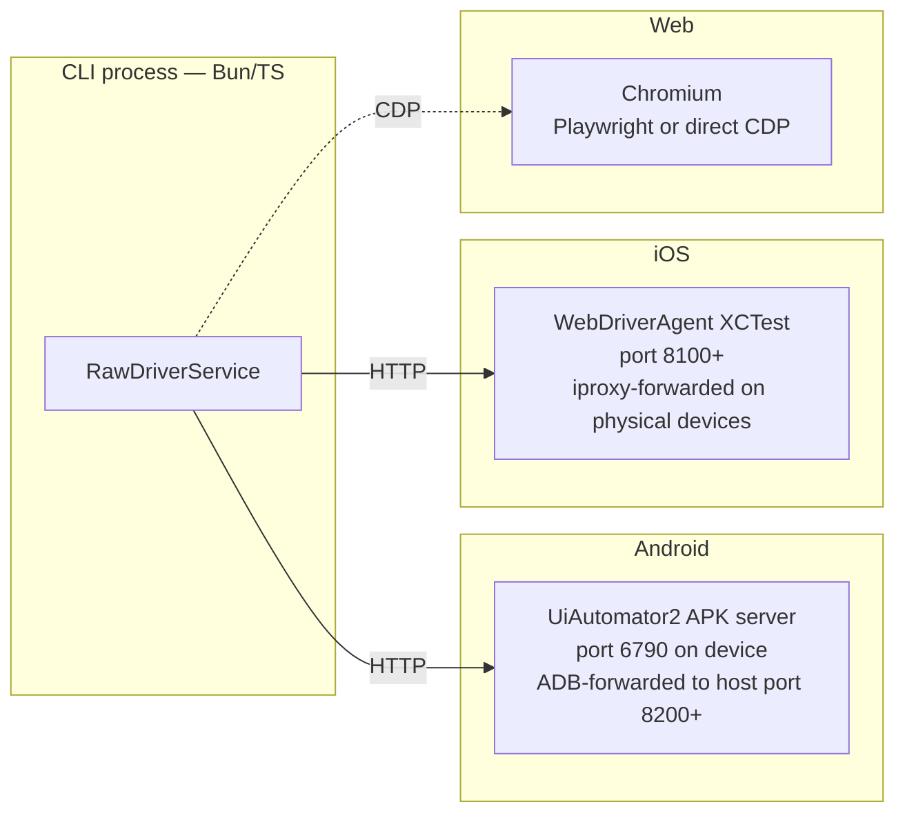

All platform interaction in spana flows through the `RawDriverService` interface. Platform-specific drivers implement this interface as thin clients (HTTP for UiAutomator2 / WebDriverAgent / Appium, CDP or Playwright for browsers and desktop webviews). The core methods carry no selection logic, no auto-wait, no retry — just raw platform calls.

## RawDriverService interface

```ts
// Simplified — see src/drivers/raw-driver.ts for the full interface.
interface RawDriverService {
  dumpHierarchy(): Effect.Effect<RawHierarchy, DriverError>;
  tapAtCoordinate(x: number, y: number): Effect.Effect<void, DriverError>;
  doubleTapAtCoordinate(x: number, y: number): Effect.Effect<void, DriverError>;
  longPressAtCoordinate(x: number, y: number, duration: number): Effect.Effect<void, DriverError>;
  swipe(
    startX: number,
    startY: number,
    endX: number,
    endY: number,
    duration: number,
  ): Effect.Effect<void, DriverError>;
  inputText(text: string): Effect.Effect<void, DriverError>;
  pressKey(key: string): Effect.Effect<void, DriverError>;
  hideKeyboard(): Effect.Effect<void, DriverError>;
  takeScreenshot(): Effect.Effect<Uint8Array, DriverError>;
  getDeviceInfo(): Effect.Effect<DeviceInfo, DriverError>;
  launchApp(bundleId: string, opts?: LaunchOptions): Effect.Effect<void, DriverError>;
  stopApp(bundleId: string): Effect.Effect<void, DriverError>;
  killApp(bundleId: string): Effect.Effect<void, DriverError>;
  clearAppState(bundleId: string): Effect.Effect<void, DriverError>;
  openLink(url: string): Effect.Effect<void, DriverError>;
  back(): Effect.Effect<void, DriverError>;
  evaluate<T>(
    script: string | ((...args: any[]) => T),
    ...args: unknown[]
  ): Effect.Effect<T, DriverError>;

  // Optional capabilities (present only on drivers that support them):
  // pinch / zoom / multiTouch, webview contexts, domChannel, network mocking,
  // cookies / auth state, tabs, console logs / JS errors / HAR, WebAuthn virtual authenticator.
  domChannel?: DomChannel;
}
```

The Smart Layer (`coordinator.ts`, `auto-wait.ts`, `element-matcher.ts`, `channel-resolver.ts`) is the main consumer of this interface. Flow authors do not normally use it directly (the debug REPL exposes it as `driver`). The optional `domChannel` is the one place selectors reach a driver: web drivers and the in-app `spana-bridge` use it to resolve and act on elements inside the page.

## Driver architecture



## Web drivers (Playwright, direct CDP, Lightpanda)

The web engine is selected with `execution.web.engine` (`resolveWebEngine()` in `src/runtime/local.ts`):

| Engine                   | Driver                       | Notes                                                                                                                                                                                         |
| ------------------------ | ---------------------------- | --------------------------------------------------------------------------------------------------------------------------------------------------------------------------------------------- |
| `"playwright"` (default) | `src/drivers/playwright.ts`  | Uses `playwright-core`. Supports `chromium`, `firefox`, `webkit`, `channel`, `wsEndpoint`, and HAR recording.                                                                                 |
| `"cdp"`                  | `src/drivers/cdp-browser.ts` | Launches Chromium itself (or attaches to `execution.web.cdpUrl`) and talks to it over a raw CDP WebSocket, with no Playwright client. Auto-attaches to cross-origin (out-of-process) iframes. |
| `"lightpanda"`           | `src/drivers/cdp-browser.ts` | Connects over CDP to an already-running Lightpanda server at `execution.web.cdpUrl` (default `http://127.0.0.1:9222`). spana does not start Lightpanda.                                       |
| `"auto"`                 | —                            | Picks `"cdp"` when the browser is Chromium and none of `wsEndpoint`, `channel`, or `artifacts.har` is set; otherwise `"playwright"`.                                                          |

- The `playwright` and `cdp` engines launch the browser (or attach to `cdpUrl` / `wsEndpoint`); all engines navigate to `apps.web.url` (default `http://localhost:3000`) and expose the page via the `RawDriverService` interface.
- `dumpHierarchy()` walks the DOM inside the page (`page.evaluate` on Playwright, `Runtime.evaluate` on CDP) and returns it as structured JSON.
- Coordinate taps are issued via `page.mouse.click(x, y)` on Playwright and `Input.dispatchMouseEvent` on CDP.
- Both drivers expose a DOM channel, so the Smart Layer can resolve selectors inside the page.

Desktop targets use the same web parser: Electron (`src/drivers/electron.ts`, Playwright `_electron` or CDP attach) and Electrobun (`src/drivers/electrobun.ts`, CDP or WebKit inspector).

## Android driver (UiAutomator2)

The Android driver is a pure HTTP client that talks to the UiAutomator2 APK server running on the device.

**Setup sequence** (`src/drivers/uiautomator2/installer.ts`):

1. spana installs the UiAutomator2 server and test APKs via ADB if they are not already on the device. The APKs come from the optional `appium-uiautomator2-server` dependency (or a local `drivers/android/` directory).
2. It starts the server on the device with `adb shell am instrument` (port 6790).
3. ADB port-forwarding maps device port 6790 to a local port (allocated from 8200).
4. The driver sends HTTP requests to `http://localhost:<forwarded-port>`.

With `execution.warmDaemons.enabled`, a healthy server from an earlier run is reused instead.

**Key endpoints** (all under `/session/:id`):

- `GET /source` — returns the full UI hierarchy as XML
- `POST /appium/gestures/click` — taps at coordinates
- `POST /appium/device/activate_app` — launches the app by package name

The driver parses the XML hierarchy in TypeScript and produces the unified `Element` tree. No XML parsing happens in the APK.

## iOS driver (WebDriverAgent)

The iOS driver is a pure HTTP client that talks to the WebDriverAgent (WDA) XCTest bundle running on the simulator or device.

spana finds the WDA Xcode project in the optional `appium-webdriveragent` dependency (or a local `drivers/ios/WebDriverAgent/` directory) and builds it with `xcodebuild` (`src/drivers/wda/installer.ts`).

**Simulator setup:**

1. On first use for a simulator, spana runs `xcodebuild build-for-testing` without code signing and caches the build in `.wda-builds/<udid>`.
2. It starts WDA with `xcodebuild test-without-building` on a port allocated from 8100.
3. The driver sends HTTP requests to `http://localhost:<port>`.

**Device setup:**

1. With `apps.ios.signing.teamId` set, spana builds WDA for the device with `DEVELOPMENT_TEAM` and `CODE_SIGN_IDENTITY` (default `"Apple Development"`), then starts it.
2. `iproxy` (from `libimobiledevice`) forwards the device port to a local port.
3. The driver connects to the forwarded port.

Without `signing`, spana assumes WDA is already running on the device and only opens the `iproxy` tunnel.

**Key endpoints** (all under `/session/:id`):

- `GET /source` — returns the full accessibility tree as XML
- `POST /wda/tap` — taps at coordinates
- `POST /wda/apps/launch` — launches the app by bundle ID

## Hierarchy parsing

Each platform returns a different hierarchy format:

| Platform                    | Format                          | Parser location                          |
| --------------------------- | ------------------------------- | ---------------------------------------- |
| Android                     | XML (UiAutomator ViewHierarchy) | `src/drivers/uiautomator2/pagesource.ts` |
| iOS                         | XML (WDA accessibility tree)    | `src/drivers/wda/pagesource.ts`          |
| Web / Electron / Electrobun | JSON (in-page DOM walk)         | `src/drivers/playwright-parser.ts`       |

All parsers output the same unified `Element` type:

```ts
// Simplified from src/schemas/element.ts
interface Element {
  id?: string; // testID / resource-id / accessibility identifier
  text?: string;
  value?: string;
  accessibilityLabel?: string;
  resourceId?: string;
  elementType?: string;
  bounds: { x: number; y: number; width: number; height: number };
  enabled?: boolean;
  visible?: boolean;
  clickable?: boolean;
  focused?: boolean;
  attributes?: Record<string, string>;
  children?: Element[];
}
```

`element-matcher.ts` in the Smart Layer searches this tree for the selector — no platform-specific code required.

## Inspiration

The thin HTTP client approach used by the WDA and UiAutomator2 drivers was inspired by [maestro-runner](https://github.com/nicklassuperset/maestro-runner), a Go project that demonstrated how minimal HTTP clients can effectively drive device interaction without heavy abstractions. The web drivers follow a similar philosophy: the `cdp` engine speaks raw CDP over a WebSocket, and the `playwright` engine calls Playwright directly rather than wrapping it in additional layers.
