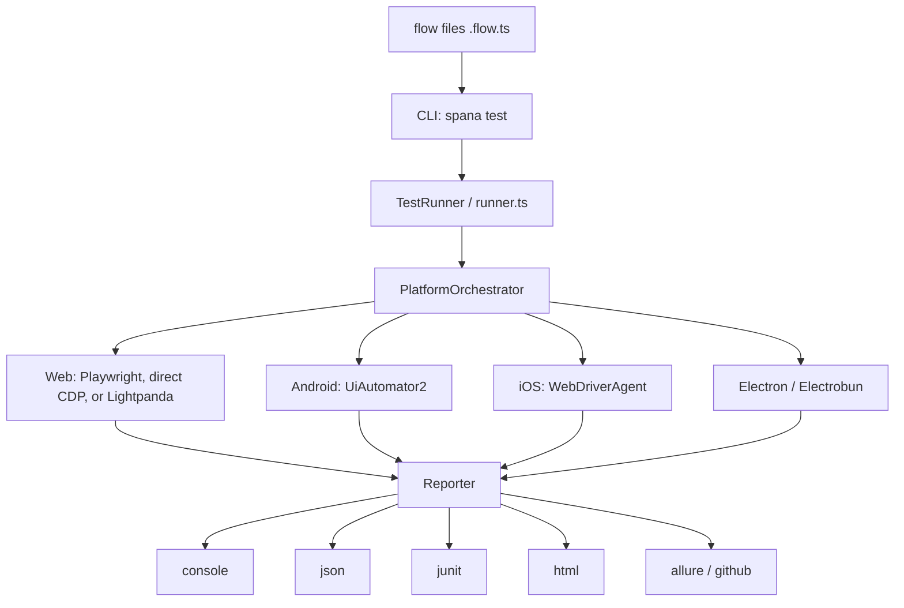
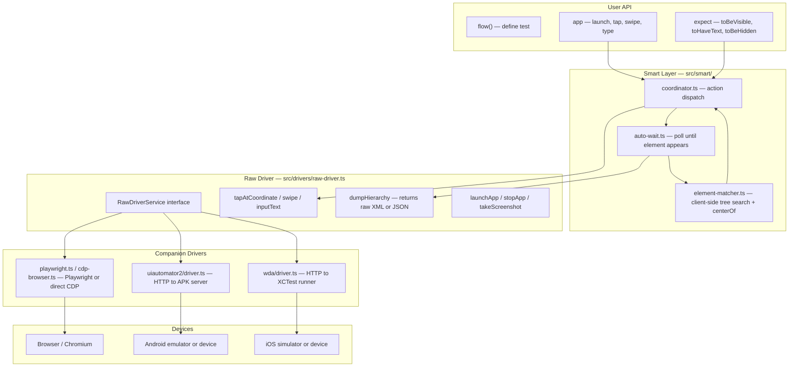
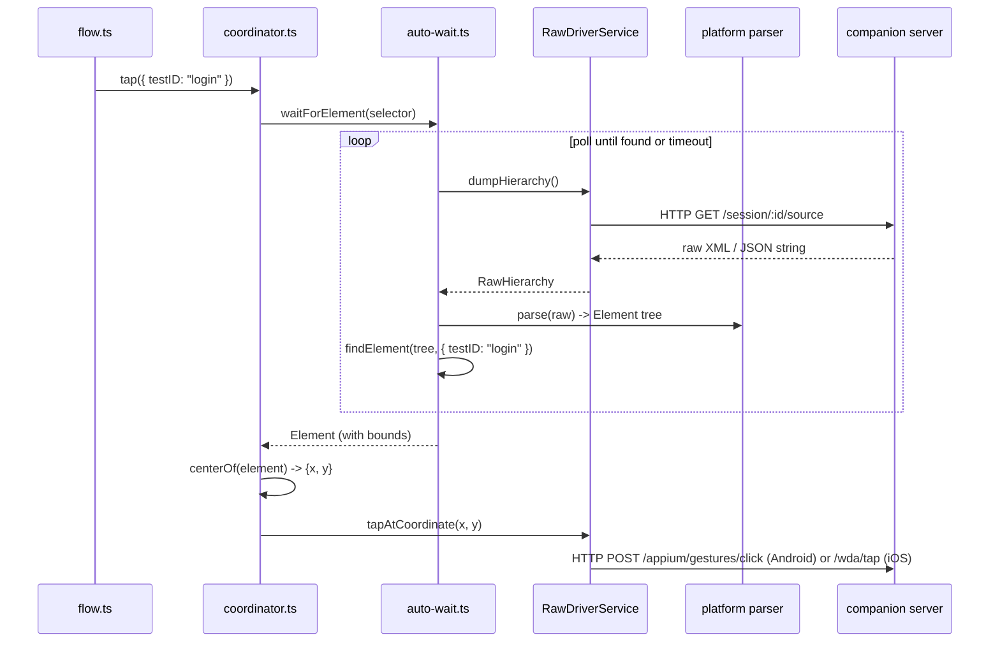
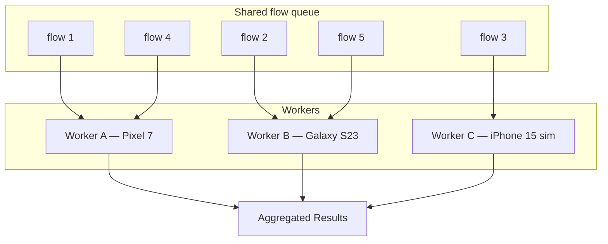
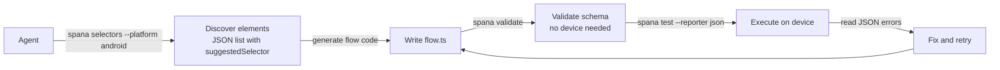

spana uses a layered architecture where all logic lives in TypeScript on the host machine. Platform drivers are thin clients (HTTP for UiAutomator2/WebDriverAgent/Appium, CDP or Playwright for browsers and desktop webviews) with no embedded selector logic.

## High-level architecture

By default, platforms run one after another so each runtime has exclusive access to its simulator, emulator, or browser. They run concurrently when you pass `--parallel`, `--workers`, or `--devices`, or set `parallelPlatforms: true` in config. Within a platform, flows run serially on one worker, or are pulled from a shared queue when the platform has several workers (see [Parallel execution](#parallel-execution)). Results are collected and passed to the configured reporter(s).

## Layered architecture

The Smart Layer resolves selectors to elements, derives center coordinates, then calls the thin `RawDriver` interface. The coordinate-level `RawDriver` methods know nothing about selectors. When a driver exposes an optional DOM channel (web drivers, or the in-app `spana-bridge` for webviews), the Smart Layer can resolve and act on selectors inside the page instead (`smart/channel-resolver.ts`).

## Element resolution flow

How `app.tap({ testID: "login" })` executes end-to-end:

The diagram shows the native (Android/iOS) path. The parser is platform-specific (XML for Android/iOS, JSON for web) but always produces the same unified `Element` tree shape. On the native path, all matching logic runs client-side in TypeScript.

## Parallel execution

Workers share a single atomic index into the flow array. Because Bun is single-threaded, the increment is naturally safe with no mutex. A faster device finishes sooner and picks up the next flow immediately, draining the queue at the speed of the fastest workers. When a previous run recorded flow durations (`spana-output/.spana/last-run.json`), the queue is ordered longest-first.

For web, `--workers <n>` creates `n` isolated browser contexts spread across `ceil(n / execution.web.maxContextsPerBrowser)` browser processes (default: 1 context per browser for the `cdp` engine, 2 for `playwright`). Android and iOS get one worker per discovered device.

- `parallel.ts` — `runParallel()` launches all workers with `Promise.all`, each looping over the queue until exhausted.
- `orchestrator.ts` — `orchestrate()` runs each platform (single worker or `runParallel()` pool). Platforms run serially unless `parallelPlatforms` is enabled.
- `runtime/local.ts` — `buildWebRuntimePool()` builds the web worker pool.

## Agent workflow

`session.ts` backs `spana hierarchy` and `spana selectors`. `Session.selectors()` dumps the element tree, flattens it, and returns only visible elements with a `testID`, `accessibilityLabel`, or `text` — each annotated with the best-priority selector to use in a flow file.

## Monorepo structure

```mermaid
graph TD
    Root[spana/]

    Root --> Packages[packages/]
    Root --> Apps[apps/]

    Packages --> PProvPkg[spana/ — core library and CLI]
    Packages --> Bridge[spana-bridge/ — in-app DOM bridge]
    Packages --> NativePkg[spana-native/ — Rust native accelerator]
    Packages --> Config[config/ — shared TS/lint config]
    Packages --> Env[env/ — environment helpers]
    Packages --> UI[ui/ — shared UI components]

    Apps --> Web[web/ — web app under test]
    Apps --> Native[native/ — React Native app under test]
    Apps --> TUI[tui/ — terminal UI]
    Apps --> Studio[studio/ — Spana Studio UI]
    Apps --> Docs[docs/]

    PProvPkg --> Src[src/]
    Src --> API[api/ — flow, app, expect user API]
    Src --> Core[core/ — engine, orchestrator, parallel, runner]
    Src --> Smart[smart/ — coordinator, auto-wait, element-matcher]
    Src --> Drivers[drivers/ — raw-driver interface + platform impls]
    Src --> Channels[channels/ — CDP, WebKit inspector, bridge DOM channels]
    Src --> Runtime[runtime/ — local, Appium, web engine selection]
    Src --> Cloud[cloud/ — BrowserStack, Sauce Labs, custom providers]
    Src --> Agent[agent/ — session.ts for agent/CLI inspection]
    Src --> CLI2[cli/ — CLI entry point]
    Src --> Device[device/ — ADB, simctl device discovery]
    Src --> Report[report/ — console, json, junit, html, allure, github reporters]
    Src --> Schemas[schemas/ — Element, Selector, DeviceInfo types]
```

