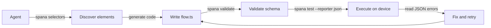

spana is built for AI coding agents (Claude Code, Codex, Cursor, Antigravity) with both a **model-free stdio MCP server** (`spana mcp`) and structured `--json` CLI commands.

## `spana mcp` (Model-Free Stdio MCP Server)

Start Spana's stdio MCP server so any MCP-compatible agent can drive a live Web, iOS, Android, Electron, or Electrobun session and export the recorded steps as a `.flow.ts` file:

```json
{
  "mcpServers": {
    "spana": {
      "command": "npx",
      "args": ["spana", "mcp"]
    }
  }
}
```

### Exposed MCP tools

The server holds one session at a time. Each action tool that succeeds returns the matching `.flow.ts` line (`codeLine`) and records it for export.

| Tool                      | Description                                                                                                                                                                                                                    |
| ------------------------- | ------------------------------------------------------------------------------------------------------------------------------------------------------------------------------------------------------------------------------ |
| `spana_session_start`     | Connect to a target (`web`, `android`, `ios`, `electron`, `electrobun`). Options: `baseUrl`, `packageName`, `bundleId`, `device`, `headless` (default `true`), and `cdpUrl` (Electron / Electrobun). Replaces any open session |
| `spana_observe`           | Return actionable elements with suggested selectors (default max 60, set `maxElements`), plus the last 15 console logs and last 10 JS errors                                                                                   |
| `spana_tap`               | Tap an element by `{ testID }`, `{ text }`, or `{ accessibilityLabel }` (add `"systemUI": true` for OS UI); records `app.tap(...)`                                                                                             |
| `spana_input_text`        | Type text into the focused control; records `app.inputText(...)`                                                                                                                                                               |
| `spana_fill`              | Tap the element, then type `value`; records `app.fill(selector, value)`                                                                                                                                                        |
| `spana_open_link`         | Open a URL or deep link; records `app.openLink(...)`                                                                                                                                                                           |
| `spana_assert_visible`    | Check the current element list once (no auto-wait) for a `testID`, `text`, or `accessibilityLabel` match; records `expect(...).toBeVisible()`. On a miss, returns up to 20 available test IDs                                  |
| `spana_assert_accessible` | Record an `expect.screen().toBeAccessible(...)` line (`standard`, `failOnSeverity`). On web, it also returns up to 10 unlabeled controls as `quickIssues`                                                                      |
| `spana_assert_screenshot` | Capture a PNG and record an `expect.screen().toMatchScreenshot(name, ...)` line (`mode`, `maxDiffPixelRatio`). It does not compare against a baseline                                                                          |

The flow `expect` API has no `expect.screen()` today, so lines recorded by `spana_assert_accessible` and `spana_assert_screenshot` must be edited before the exported flow runs. Use `expect(selector).toPassAccessibilityAudit()` and `expect(selector).toMatchScreenshot(name)` instead.
| `spana_screenshot` | Return a PNG screenshot of the current screen |
| `spana_diagnostics` | Return element and `testID` counts, the last 25 console logs, and the last 15 JS errors |
| `spana_export_flow` | Return the recorded steps as a `.flow.ts` file without disconnecting |
| `spana_session_stop` | Disconnect and return the generated `.flow.ts` file |
| `spana_run_flow` | Run an existing `.flow.ts` file (optional `platform`) and return `passed: true/false` |

## Verified Replay Cache (`.spana/cache/` & `--strict-cache`)

`ReplaySession` and `ReplayCacheStore` (exported from `spana-test`) record agentic actions to `.spana/cache/` only **after** a real assertion verifies them. On a cache hit, `ReplaySession.act()` replays the recorded actions with no LLM call.

`ReplaySession` has three modes: `read-write` (default: on a miss or mismatch, hand off to the executor and save the healed recording), `strict` (fail on a missing or mismatched recording), and `off`.

```bash
# Accepted by the CLI, but not yet passed to the runner
spana test --strict-cache
```

Today, `spana test` accepts `--strict-cache` and the `replayCache` config key but does not use them. To get strict mode, create `ReplaySession` with `mode: "strict"` in your own code.

## `spana selectors`

List all actionable elements on screen with suggested selectors.

```bash
spana selectors --platform <platform> [--config path] [--json] [--pretty]
```

Plain output is a JSON array. With `--json`, Spana wraps that array in a versioned machine-readable envelope.

```bash
spana selectors --platform android
```

```json
[
  {
    "suggestedSelector": { "testID": "login-button" },
    "elementType": "android.widget.Button",
    "text": "Sign In",
    "bounds": { "x": 24, "y": 480, "width": 328, "height": 48 },
    "id": "login-button"
  },
  {
    "suggestedSelector": { "text": "Forgot password?" },
    "elementType": "android.widget.TextView",
    "text": "Forgot password?",
    "bounds": { "x": 120, "y": 544, "width": 136, "height": 20 }
  }
]
```

Only visible elements with an `id`, `text`, or `accessibilityLabel` are listed. Fields without a value are left out.

`suggestedSelector` follows priority: `testID` (from `id`) > `accessibilityLabel` > `text`. Feed this output directly to an agent to choose which element to interact with.

### Filtering with `jq`

```bash
# Elements that have a testID
spana selectors --platform web | jq '.[] | select(.id != null)'

# Just the suggested selectors
spana selectors --platform ios | jq '[.[].suggestedSelector]'
```

## `spana hierarchy`

Dump the full UI element tree as structured JSON.

```bash
spana hierarchy --platform <platform> [--config path] [--json] [--pretty]
```

Plain output is the raw hierarchy JSON. With `--json`, Spana wraps it in a versioned machine-readable envelope.

```bash
spana hierarchy --platform web --pretty
```

```json
{
  "elementType": "body",
  "bounds": { "x": 0, "y": 0, "width": 375, "height": 812 },
  "children": [
    {
      "elementType": "main",
      "bounds": { "x": 0, "y": 0, "width": 375, "height": 812 },
      "children": [
        {
          "elementType": "textbox",
          "id": "email-input",
          "bounds": { "x": 24, "y": 200, "width": 328, "height": 44 }
        }
      ]
    }
  ]
}
```

On web, `elementType` is the ARIA role, or the HTML tag when there is no role. Each node can have `id`, `text`, `value`, `accessibilityLabel`, `resourceId`, `elementType`, `bounds`, `enabled`, `visible`, `clickable`, `focused`, `attributes`, and `children`.

Use `spana hierarchy` when `spana selectors` does not include the element you need, or to understand the structural relationship between elements.

## `spana validate`

Validate flow files without a device connection. Catches common mistakes before running tests.

```bash
spana validate [path] [--json]
```

`path` defaults to `./flows`. Exits `0` if all flows are valid, non-zero if any errors found. Does not execute the flows.

**Checks performed:**

- Every flow loads and has a `name` and `fn`
- No duplicate flow names across files
- Platform values are valid (`web`, `android`, `ios` only)
- Flow directory exists and contains flow files

```bash
spana validate
# ✓ 5 flow(s) valid

spana validate flows/
# ✗ flows/login.flow.ts: Duplicate flow name "Login test" (also in flows/auth.flow.ts)
# ✗ flows/broken.flow.ts: Invalid platform "windows" - must be web, android, or ios
# ✗ flows/empty.flow.ts: Invalid flow definition: missing name or fn
```

Use `spana validate` in CI preflight or as part of an agent loop before committing generated flow files.

## Agent workflow

The typical agent-driven authoring loop:

```bash
# 1. Navigate the app to the screen you want to test, then discover elements
spana selectors --platform android | jq '.[] | select(.id != null)'

# 2. Generate and write a flow file (done by the agent)

# 3. Validate the flow without a device
spana validate flows/my-new-flow.ts

# 4. Run the flow and capture JSON results (one JSON event per line)
spana test flows/my-new-flow.ts --reporter json

# 5. Read failures from the JSON events and iterate
spana test flows/my-new-flow.ts --reporter json | jq -R 'fromjson? | select(.event == "flowFail")'
```

This loop requires no manual interaction. `spana validate` catches structural errors before device time is spent. `--reporter json` gives the agent machine-readable pass/fail data with error messages.



## Agent skill file

spana ships with a ready-made skill file for AI coding agents at `.agents/skills/spana-testing/SKILL.md` in the repo. It covers element discovery, flow writing patterns, selectors, validation, error handling, and platform-specific notes.

**To use it with your AI agent:**

1. Copy the skill file into your project:

   ```bash
   mkdir -p .agents/skills/spana-testing
   cp node_modules/spana-test/.agents/skills/spana-testing/SKILL.md .agents/skills/spana-testing/
   ```

2. Or reference it in your `CLAUDE.md` / `AGENTS.md`:

   ```markdown
   ## Testing

   For writing E2E tests, follow the spana testing skill at:
   .agents/skills/spana-testing/SKILL.md
   ```

3. Or point your agent to it directly:
   ```
   Read .agents/skills/spana-testing/SKILL.md and use it to write a test for the login flow.
   ```

The skill file is self-contained — it includes the full API reference, workflow loop, and common patterns so the agent can start writing tests immediately.
