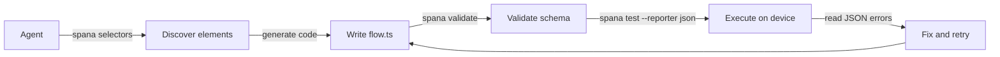

spana is built for AI coding agents (Claude Code, Codex, Cursor, Antigravity) with both a **model-free stdio MCP server** (`spana mcp`) and structured `--json` CLI commands.

## `spana mcp` (Model-Free Stdio MCP Server)

Start Spana's stdio MCP server so any MCP-compatible agent can drive live Web, iOS, Android, Electron, or Electrobun sessions at sub-5 ms tool latency and export verified `.flow.ts` files:

```json
{
  "mcpServers": {
    "spana": {
      "command": "npx",
      "args": ["spana", "mcp"]
    }
  }
}
```

### Exposed MCP tools

| Tool                                         | Description                                                                           | Typical Web Latency |
| -------------------------------------------- | ------------------------------------------------------------------------------------- | ------------------: |
| `spana_session_start`                        | Launch/connect a live session (`web`, `android`, `ios`, `electron`, `electrobun`)     |             ~125 ms |
| `spana_observe`                              | Return a compact interactive accessibility/DOM snapshot (~273 tokens avg)             |            1.4–8 ms |
| `spana_tap`                                  | Tap an element by `{ testID }`, `{ text }`, `{ accessibilityLabel }`, or `systemUI()` |          2.8–4.0 ms |
| `spana_input_text` / `spana_press_key`       | Type text or press keys in the focused control                                        |              1.4 ms |
| `spana_assert_visible` / `spana_assert_text` | Run real auto-waiting assertions                                                      |             0.97 ms |
| `spana_diagnostics`                          | Read captured browser console logs & uncaught JS errors                               |             0.82 ms |
| `spana_screenshot`                           | Capture a PNG screenshot for visual inspection                                        |              ~35 ms |
| `spana_export_flow`                          | Emit a clean, deterministic `.flow.ts` file from the verified session                 |             0.06 ms |
| `spana_run_flow` / `spana_session_stop`      | Run an existing `.flow.ts` or close the session                                       |              ~14 ms |

## Verified Replay Cache (`.spana/cache/` & `--strict-cache`)

`ReplaySession` and `ReplayCacheStore` record agentic actions only **after** real assertions pass, then replay them deterministically in CI with zero LLM calls (measured **238.8× faster**: `1,433 ms → 6 ms`).

```bash
# Enforce 0-LLM deterministic replay in CI (fails loudly on cache miss)
spana test --strict-cache
```

## `spana selectors`

List all actionable elements on screen with suggested selectors.

```bash
spana selectors --platform <platform> [--config path] [--json] [--pretty]
```

Plain output is a JSON array. With `--json`, Spana wraps that array in a versioned machine-readable envelope.

```bash
spana selectors --platform android
```

```json
[
  {
    "testID": "login-button",
    "text": "Sign In",
    "accessibilityLabel": null,
    "bounds": { "x": 24, "y": 480, "width": 328, "height": 48 },
    "suggestedSelector": { "testID": "login-button" }
  },
  {
    "testID": null,
    "text": "Forgot password?",
    "accessibilityLabel": null,
    "bounds": { "x": 120, "y": 544, "width": 136, "height": 20 },
    "suggestedSelector": { "text": "Forgot password?" }
  }
]
```

`suggestedSelector` follows priority: `testID` > `accessibilityLabel` > `text`. Feed this output directly to an agent to choose which element to interact with.

### Filtering with `jq`

```bash
# Elements that have a testID
spana selectors --platform web | jq '.[] | select(.testID != null)'

# Just the suggested selectors
spana selectors --platform ios | jq '[.[].suggestedSelector]'
```

## `spana hierarchy`

Dump the full UI element tree as structured JSON.

```bash
spana hierarchy --platform <platform> [--config path] [--json] [--pretty]
```

Plain output is the raw hierarchy JSON. With `--json`, Spana wraps it in a versioned machine-readable envelope.

```bash
spana hierarchy --platform web --pretty
```

```json
{
  "role": "application",
  "children": [
    {
      "role": "main",
      "children": [
        {
          "role": "textbox",
          "testID": "email-input",
          "text": "",
          "bounds": { "x": 24, "y": 200, "width": 328, "height": 44 }
        }
      ]
    }
  ]
}
```

Use `spana hierarchy` when `spana selectors` does not include the element you need, or to understand the structural relationship between elements.

## `spana validate`

Validate flow files without a device connection. Catches common mistakes before running tests.

```bash
spana validate [path] [--json]
```

`path` defaults to `flowDir`. Exits `0` if all flows are valid, non-zero if any errors found. Does not execute the flows.

**Checks performed:**

- Flow files have a valid default export with `name` and `fn`
- No duplicate flow names across files
- Platform values are valid (`web`, `android`, `ios` only)
- Flow directory exists and contains flow files

```bash
spana validate
# ✓ 5 flow(s) valid

spana validate flows/
# ✗ flows/login.flow.ts: Duplicate flow name "Login test" (also in flows/auth.flow.ts)
# ✗ flows/broken.flow.ts: Invalid platform "windows" — must be web, android, or ios
# ✗ flows/empty.flow.ts: export default is not a FlowDefinition
```

Use `spana validate` in CI preflight or as part of an agent loop before committing generated flow files.

## Agent workflow

The typical agent-driven authoring loop:

```bash
# 1. Navigate the app to the screen you want to test, then discover elements
spana selectors --platform android | jq '.[] | select(.testID != null)'

# 2. Generate and write a flow file (done by the agent)

# 3. Validate the flow without a device
spana validate flows/my-new-flow.ts

# 4. Run the flow and capture JSON results
spana test flows/my-new-flow.ts --reporter json 2>&1

# 5. Read errors from JSON output and iterate
spana test flows/my-new-flow.ts --reporter json 2>&1 | jq '.results[] | select(.status == "failed")'
```

This loop requires no manual interaction. `spana validate` catches structural errors before device time is spent. `--reporter json` gives the agent machine-readable pass/fail data with error messages.



## Agent skill file

spana ships with a ready-made skill file for AI coding agents at `.agents/skills/spana-testing/SKILL.md` in the repo. It covers element discovery, flow writing patterns, selectors, validation, error handling, and platform-specific notes.

**To use it with your AI agent:**

1. Copy the skill file into your project:

   ```bash
   mkdir -p .agents/skills/spana-testing
   cp node_modules/spana-test/.agents/skills/spana-testing/SKILL.md .agents/skills/spana-testing/
   ```

2. Or reference it in your `CLAUDE.md` / `AGENTS.md`:

   ```markdown
   ## Testing

   For writing E2E tests, follow the spana testing skill at:
   .agents/skills/spana-testing/SKILL.md
   ```

3. Or point your agent to it directly:
   ```
   Read .agents/skills/spana-testing/SKILL.md and use it to write a test for the login flow.
   ```

The skill file is self-contained — it includes the full API reference, workflow loop, and common patterns so the agent can start writing tests immediately.
